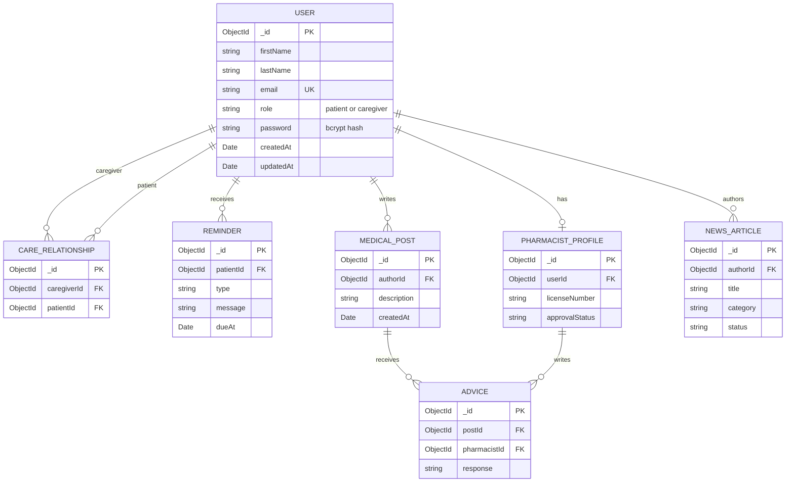

# E-Pharmacist account data model

The full project concept includes accounts, care relationships, reminders, medical posts, pharmacist advice, and news. Sprint I implements only `USER`: patient and caregiver accounts share one MongoDB `users` collection, distinguished by `role`. The other entities below show planned relationships for later sprints.

| Field | Rule |
| --- | --- |
| `_id` | MongoDB document ID |
| `firstName`, `lastName` | Required, trimmed, 60 characters maximum |
| `email` | Required, normalized to lowercase, validated, unique index |
| `role` | Required; `patient` or `caregiver` |
| `password` | Required, minimum 8 characters before hashing; stored as a salted bcrypt hash and excluded from default queries |
| `createdAt`, `updatedAt` | Managed by Mongoose timestamps |

The `USER` schema is implemented in [`models/userModel.js`](../models/userModel.js). The remaining entities are a design proposal only and can change as later backlog items are refined. A single account collection avoids duplicating shared fields; role-specific records can reference `users._id` when those features are developed.
